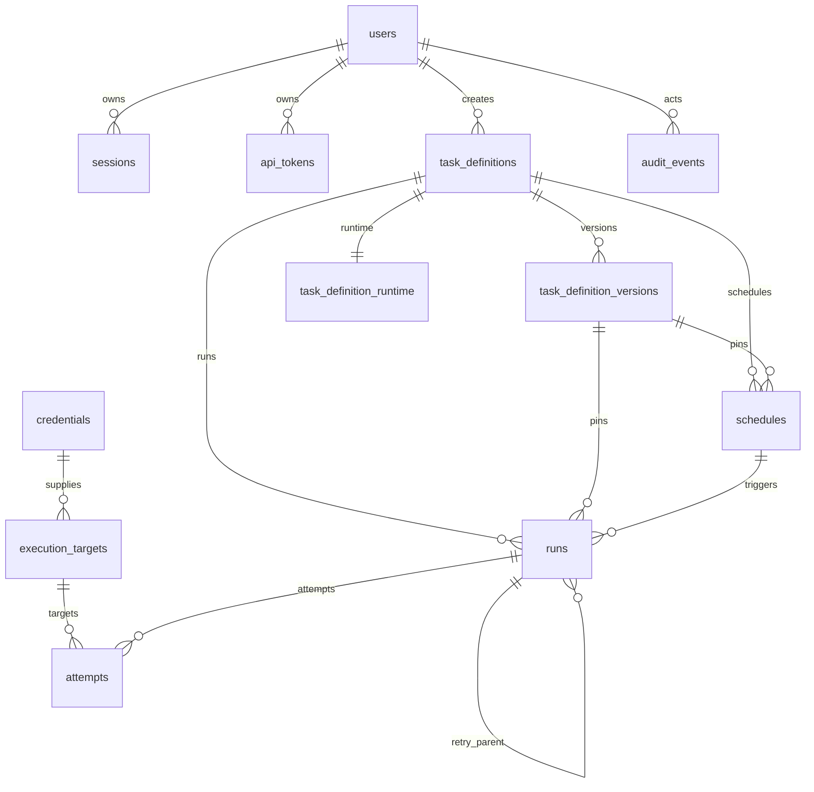

# Phase 1 Data Model: 任务中控系统

**Feature**: `001-task-control-center` | **Date**: 2026-10-30

数据库：PostgreSQL 16，独立 schema `task_control`。所有时间点使用 `timestamptz` 并以 UTC 存储；
所有主键使用 `uuid`（`gen_random_uuid()`）；可编辑聚合带 `version integer` 做乐观并发。

## Entity Relationship Overview



## Conventions

- 枚举使用 `varchar` + `CHECK`，便于迁移；应用层枚举与数据库检查保持一致。
- 所有表含 `created_at timestamptz NOT NULL DEFAULT now()`；可变聚合含 `updated_at`。
- 软删除优先：任务定义用 `archived_at`，用户/目标/凭据用 `is_active`/`disabled_at`；
  运行、尝试、审计不可物理删除，仅由保留任务清理过期明细。
- 金额/时间/数量字段使用明确类型，不使用字符串承载。
- JSONB 仅用于参数、策略、执行器配置和审计详情；核心查询字段单独建列。

## Tables

### `users`

| Column | Type | Constraints / Notes |
|--------|------|---------------------|
| `id` | uuid | PK, default `gen_random_uuid()` |
| `username` | varchar(64) | NOT NULL；唯一索引 `lower(username)`；仅 `[a-z0-9._-]` |
| `display_name` | varchar(128) | NOT NULL |
| `password_hash` | text | NOT NULL；Argon2id 编码串 |
| `role` | varchar(16) | NOT NULL；CHECK `admin/operator/viewer` |
| `is_active` | boolean | NOT NULL DEFAULT true |
| `must_change_password` | boolean | NOT NULL DEFAULT false |
| `failed_login_count` | integer | NOT NULL DEFAULT 0；CHECK >= 0 |
| `locked_until` | timestamptz | NULL |
| `last_login_at` | timestamptz | NULL |
| `created_at` | timestamptz | NOT NULL DEFAULT now() |
| `updated_at` | timestamptz | NOT NULL DEFAULT now() |
| `version` | integer | NOT NULL DEFAULT 1；乐观并发 |

索引：`ux_users_username_lower` unique on `lower(username)`；`ix_users_role_active` on `(role, is_active)`。

### `sessions`

| Column | Type | Constraints / Notes |
|--------|------|---------------------|
| `id` | uuid | PK |
| `user_id` | uuid | NOT NULL；FK `users(id)` ON DELETE CASCADE |
| `token_hash` | bytea | NOT NULL UNIQUE；SHA-256(session token) |
| `csrf_token_hash` | bytea | NOT NULL；SHA-256(csrf token) |
| `ip_address` | inet | NULL |
| `user_agent` | varchar(512) | NULL |
| `created_at` | timestamptz | NOT NULL DEFAULT now() |
| `last_seen_at` | timestamptz | NOT NULL DEFAULT now() |
| `expires_at` | timestamptz | NOT NULL；空闲+绝对过期取较早者 |
| `revoked_at` | timestamptz | NULL |

索引：`ix_sessions_user` on `(user_id, revoked_at)`；`ix_sessions_expires` on `expires_at`。

### `api_tokens`

| Column | Type | Constraints / Notes |
|--------|------|---------------------|
| `id` | uuid | PK |
| `user_id` | uuid | NOT NULL；FK `users(id)` ON DELETE CASCADE |
| `name` | varchar(64) | NOT NULL |
| `token_prefix` | varchar(12) | NOT NULL；用于 UI 识别 |
| `token_hash` | bytea | NOT NULL UNIQUE；SHA-256(token) |
| `expires_at` | timestamptz | NULL |
| `last_used_at` | timestamptz | NULL |
| `revoked_at` | timestamptz | NULL |
| `created_at` | timestamptz | NOT NULL DEFAULT now() |

索引：`ix_api_tokens_user` on `(user_id, revoked_at)`。

### `task_definitions`

| Column | Type | Constraints / Notes |
|--------|------|---------------------|
| `id` | uuid | PK |
| `key` | varchar(100) | NOT NULL UNIQUE；`^[a-z][a-z0-9_-]{1,99}$` |
| `name` | varchar(160) | NOT NULL |
| `description` | text | NULL |
| `active_version_id` | uuid | NULL；FK `task_definition_versions(id)`；`DEFERRABLE INITIALLY DEFERRED` |
| `is_archived` | boolean | NOT NULL DEFAULT false |
| `archived_at` | timestamptz | NULL |
| `created_by` | uuid | NOT NULL；FK `users(id)` ON DELETE RESTRICT |
| `created_at` | timestamptz | NOT NULL DEFAULT now() |
| `updated_at` | timestamptz | NOT NULL DEFAULT now() |
| `version` | integer | NOT NULL DEFAULT 1 |

约束：`CHECK (is_archived = (archived_at IS NOT NULL))`。索引：`ix_definitions_active` on `(is_archived, updated_at DESC)`。

### `task_definition_versions`

| Column | Type | Constraints / Notes |
|--------|------|---------------------|
| `id` | uuid | PK |
| `definition_id` | uuid | NOT NULL；FK `task_definitions(id)` ON DELETE RESTRICT |
| `version_no` | integer | NOT NULL；CHECK > 0 |
| `executor_type` | varchar(16) | NOT NULL；CHECK `local/ssh/http` |
| `parameter_schema` | jsonb | NOT NULL；JSON Schema 2020-12 子集 |
| `executor_config` | jsonb | NOT NULL；按类型校验，含执行目标引用、命令/URL/请求模板，不含明文凭据 |
| `timeout_seconds` | integer | NOT NULL；CHECK 1..86400 |
| `retry_policy` | jsonb | NOT NULL；最大尝试/退避/可重试分类/退出码 |
| `max_concurrency` | integer | NOT NULL DEFAULT 1；CHECK 1..100 |
| `checksum` | char(64) | NOT NULL；规范化内容 SHA-256 |
| `created_by` | uuid | NOT NULL；FK `users(id)` ON DELETE RESTRICT |
| `created_at` | timestamptz | NOT NULL DEFAULT now() |

唯一：`uq_definition_version` on `(definition_id, version_no)`。索引：`ix_version_definition` on
`(definition_id, version_no DESC)`。

版本不可变：应用层禁止 UPDATE 业务字段；只允许读取和引用。定义修改时插入新版本并切换
`active_version_id`。

### `execution_targets`

| Column | Type | Constraints / Notes |
|--------|------|---------------------|
| `id` | uuid | PK |
| `name` | varchar(120) | NOT NULL UNIQUE |
| `type` | varchar(16) | NOT NULL；CHECK `local/ssh/http` |
| `config` | jsonb | NOT NULL；本机脚本根/命令白名单、SSH host/port/user、HTTP base URL 等 |
| `credential_id` | uuid | NULL；FK `credentials(id)` ON DELETE SET NULL |
| `is_active` | boolean | NOT NULL DEFAULT true |
| `created_by` | uuid | NOT NULL；FK `users(id)` ON DELETE RESTRICT |
| `created_at` | timestamptz | NOT NULL DEFAULT now() |
| `updated_at` | timestamptz | NOT NULL DEFAULT now() |
| `version` | integer | NOT NULL DEFAULT 1 |

约束：`type='local'` 时 `credential_id` 必须为 NULL（本机脚本不需凭据）。HTTP 目标必须有
`base_url` 且 scheme 为 http/https；SSH 目标必须有 host/port；本机目标必须有 `script_root`。

### `credentials`

| Column | Type | Constraints / Notes |
|--------|------|---------------------|
| `id` | uuid | PK |
| `name` | varchar(120) | NOT NULL UNIQUE |
| `kind` | varchar(16) | NOT NULL；CHECK `password/ssh_key/http_bearer/http_basic` |
| `ciphertext` | bytea | NOT NULL；AES-256-GCM（nonce+ciphertext+tag） |
| `key_version` | integer | NOT NULL；对应 key ring 版本 |
| `metadata` | jsonb | NOT NULL DEFAULT '{}'；用户名/指纹/掩码，不含密文 |
| `is_active` | boolean | NOT NULL DEFAULT true |
| `created_by` | uuid | NOT NULL；FK `users(id)` ON DELETE RESTRICT |
| `created_at` | timestamptz | NOT NULL DEFAULT now() |
| `updated_at` | timestamptz | NOT NULL DEFAULT now() |
| `version` | integer | NOT NULL DEFAULT 1 |

AAD 绑定 `credential.id + kind`。API 只返回名称、kind、掩码元数据、状态和时间。

### `schedules`

| Column | Type | Constraints / Notes |
|--------|------|---------------------|
| `id` | uuid | PK |
| `definition_id` | uuid | NOT NULL；FK `task_definitions(id)` ON DELETE RESTRICT |
| `definition_version_id` | uuid | NOT NULL；FK `task_definition_versions(id)` ON DELETE RESTRICT |
| `target_id` | uuid | NULL；FK `execution_targets(id)` ON DELETE SET NULL |
| `target_snapshot` | jsonb | NOT NULL；创建调度时的目标配置快照（不含凭据明文） |
| `name` | varchar(120) | NOT NULL |
| `trigger_type` | varchar(16) | NOT NULL；CHECK `once/cron/interval` |
| `fire_at` | timestamptz | NULL；once 必填 |
| `cron_expr` | varchar(128) | NULL；cron 必填 |
| `interval_seconds` | integer | NULL；interval 必填，CHECK >= 10 |
| `timezone` | varchar(64) | NOT NULL DEFAULT 'UTC'；IANA 名称 |
| `parameters` | jsonb | NOT NULL；敏感字段加密后的快照 |
| `parameters_redacted` | jsonb | NOT NULL；UI/列表展示 |
| `overlap_policy` | varchar(16) | NOT NULL DEFAULT 'skip'；CHECK `skip/queue` |
| `misfire_grace_seconds` | integer | NOT NULL DEFAULT 3600；CHECK >= 0 |
| `status` | varchar(16) | NOT NULL；CHECK `active/paused/completed/cancelled` |
| `next_fire_at` | timestamptz | NULL；active 时必填 |
| `last_fire_at` | timestamptz | NULL |
| `created_by` | uuid | NOT NULL；FK `users(id)` ON DELETE RESTRICT |
| `created_at` | timestamptz | NOT NULL DEFAULT now() |
| `updated_at` | timestamptz | NOT NULL DEFAULT now() |
| `version` | integer | NOT NULL DEFAULT 1 |

约束：
- `CHECK ((trigger_type='once' AND fire_at IS NOT NULL) OR (trigger_type='cron' AND cron_expr IS NOT NULL) OR (trigger_type='interval' AND interval_seconds IS NOT NULL))`
- `CHECK (status <> 'active' OR next_fire_at IS NOT NULL)`
- `CHECK (status IN ('active','paused','completed','cancelled'))`

索引：`ix_schedules_due` on `(next_fire_at)` WHERE `status='active'`；
`ix_schedules_definition` on `(definition_id, created_at DESC)`。

### `runs`

| Column | Type | Constraints / Notes |
|--------|------|---------------------|
| `id` | uuid | PK |
| `definition_id` | uuid | NOT NULL；FK `task_definitions(id)` ON DELETE RESTRICT |
| `definition_version_id` | uuid | NOT NULL；FK `task_definition_versions(id)` ON DELETE RESTRICT |
| `target_id` | uuid | NULL；FK `execution_targets(id)` ON DELETE SET NULL |
| `target_snapshot` | jsonb | NOT NULL；提交/触发时的目标配置快照（不含凭据明文） |
| `schedule_id` | uuid | NULL；FK `schedules(id)` ON DELETE SET NULL |
| `scheduled_for` | timestamptz | NULL；调度触发点；once/cron/interval 必填 |
| `trigger_type` | varchar(16) | NOT NULL；CHECK `immediate/once/cron/interval` |
| `status` | varchar(16) | NOT NULL；见状态机 |
| `idempotency_key` | varchar(128) | NULL；客户端提供 |
| `request_hash` | char(64) | NULL；幂等请求体哈希 |
| `parameters` | jsonb | NOT NULL；不可变参数快照（敏感字段加密） |
| `parameters_redacted` | jsonb | NOT NULL；脱敏视图 |
| `queued_at` | timestamptz | NULL |
| `started_at` | timestamptz | NULL |
| `finished_at` | timestamptz | NULL |
| `next_retry_at` | timestamptz | NULL |
| `attempt_count` | integer | NOT NULL DEFAULT 0；CHECK >= 0 |
| `max_attempts` | integer | NOT NULL；CHECK 1..10 |
| `worker_id` | uuid | NULL；FK `workers(id)` ON DELETE SET NULL |
| `lease_expires_at` | timestamptz | NULL |
| `parent_run_id` | uuid | NULL；FK `runs(id)` ON DELETE SET NULL；手工重试来源 |
| `cancel_requested_at` | timestamptz | NULL |
| `cancel_requested_by` | uuid | NULL；FK `users(id)` ON DELETE SET NULL |
| `error_code` | varchar(64) | NULL |
| `error_message` | text | NULL；脱敏、限长 |
| `result_summary` | jsonb | NULL；退出码/HTTP 状态/耗时摘要 |
| `created_by` | uuid | NOT NULL；FK `users(id)` ON DELETE RESTRICT |
| `created_at` | timestamptz | NOT NULL DEFAULT now() |
| `updated_at` | timestamptz | NOT NULL DEFAULT now() |
| `version` | integer | NOT NULL DEFAULT 1 |

唯一/索引：
- `uq_runs_idempotency` unique on `(created_by, idempotency_key)` WHERE `idempotency_key IS NOT NULL`
- `uq_runs_schedule_occurrence` unique on `(schedule_id, scheduled_for)` WHERE `schedule_id IS NOT NULL`
- `ix_runs_queue` on `(queued_at, id)` WHERE `status='queued'`
- `ix_runs_retry` on `(next_retry_at)` WHERE `status='retry_wait'`
- `ix_runs_definition_time` on `(definition_id, created_at DESC)`
- `ix_runs_status_time` on `(status, created_at DESC)`
- `ix_runs_schedule_time` on `(schedule_id, scheduled_for DESC)`
- `ix_runs_target` on `(target_id, created_at DESC)`
- `ix_runs_lease` on `(lease_expires_at)` WHERE `status='running'`
- `ix_runs_parent` on `parent_run_id`
- `ix_runs_retention` on `created_at`

约束：
- `CHECK (finished_at IS NULL OR started_at IS NULL OR finished_at >= started_at)`
- `CHECK (schedule_id IS NULL OR scheduled_for IS NOT NULL)`
- `CHECK (attempt_count <= max_attempts)`
- `CHECK (status IN ('scheduled','queued','running','retry_wait','succeeded','failed','cancelled','skipped','missed'))`

### `attempts`

| Column | Type | Constraints / Notes |
|--------|------|---------------------|
| `id` | uuid | PK |
| `run_id` | uuid | NOT NULL；FK `runs(id)` ON DELETE CASCADE |
| `attempt_no` | integer | NOT NULL；CHECK > 0 |
| `status` | varchar(16) | NOT NULL；CHECK `running/succeeded/failed/timed_out/cancelled` |
| `executor_type` | varchar(16) | NOT NULL |
| `target_id` | uuid | NULL；FK `execution_targets(id)` ON DELETE SET NULL |
| `worker_id` | uuid | NULL；FK `workers(id)` ON DELETE SET NULL |
| `started_at` | timestamptz | NOT NULL DEFAULT now() |
| `finished_at` | timestamptz | NULL |
| `duration_ms` | integer | NULL；CHECK >= 0 |
| `exit_code` | integer | NULL |
| `http_status` | integer | NULL |
| `error_class` | varchar(64) | NULL；如 `TIMEOUT`/`CONNECTION`/`HTTP_5XX` |
| `error_message` | text | NULL；脱敏、限长 |
| `stdout_excerpt` | text | NULL；<= 1 MB 截断 |
| `stderr_excerpt` | text | NULL；<= 1 MB 截断 |
| `response_excerpt` | text | NULL；<= 1 MB 截断 |
| `created_at` | timestamptz | NOT NULL DEFAULT now() |

唯一：`uq_attempt_no` on `(run_id, attempt_no)`。索引：`ix_attempt_run` on `(run_id, attempt_no)`；
`ix_attempt_created` on `created_at`。

### `task_definition_runtime`

| Column | Type | Constraints / Notes |
|--------|------|---------------------|
| `definition_id` | uuid | PK；FK `task_definitions(id)` ON DELETE CASCADE |
| `running_count` | integer | NOT NULL DEFAULT 0；CHECK >= 0 |
| `max_concurrency` | integer | NOT NULL DEFAULT 1；CHECK 1..100 |
| `updated_at` | timestamptz | NOT NULL DEFAULT now() |

用于 worker 原子占用/释放并发槽；定义新版本时同步 `max_concurrency`，但不能低于当前运行数。

### `workers`

| Column | Type | Constraints / Notes |
|--------|------|---------------------|
| `id` | uuid | PK |
| `hostname` | varchar(255) | NOT NULL |
| `pid` | integer | NOT NULL |
| `role` | varchar(16) | NOT NULL；CHECK `worker/scheduler` |
| `started_at` | timestamptz | NOT NULL DEFAULT now() |
| `last_heartbeat_at` | timestamptz | NOT NULL DEFAULT now() |
| `stopped_at` | timestamptz | NULL |

索引：`ix_workers_heartbeat` on `(role, last_heartbeat_at DESC)`。

### `audit_events`

| Column | Type | Constraints / Notes |
|--------|------|---------------------|
| `id` | bigserial | PK |
| `actor_user_id` | uuid | NULL；FK `users(id)` ON DELETE SET NULL；系统动作为 NULL |
| `action` | varchar(64) | NOT NULL；如 `definition.create` |
| `resource_type` | varchar(32) | NOT NULL |
| `resource_id` | varchar(64) | NULL |
| `outcome` | varchar(16) | NOT NULL；CHECK `success/failure/denied` |
| `ip_address` | inet | NULL |
| `user_agent` | varchar(512) | NULL |
| `correlation_id` | varchar(64) | NOT NULL |
| `details` | jsonb | NOT NULL DEFAULT '{}'；脱敏差异/原因 |
| `created_at` | timestamptz | NOT NULL DEFAULT now() |

索引：`ix_audit_time` on `(created_at DESC)`；`ix_audit_actor` on `(actor_user_id, created_at DESC)`；
`ix_audit_resource` on `(resource_type, resource_id, created_at DESC)`。

## State Machines

### Task Run

```text
scheduled --due--> queued --claim--> running --success--> succeeded
scheduled --cancel--> cancelled
queued --cancel--> cancelled
running --retryable fail--> retry_wait --due--> queued
running --non-retryable/exhausted--> failed
running --cancel--> cancelled
scheduler --> skipped   (overlap policy = skip)
scheduler --> missed    (outside grace window)
scheduled --definition disabled--> cancelled (DEFINITION_DISABLED)
```

- `succeeded/failed/cancelled/skipped/missed` 为终态；除保留清理外不可修改。
- 禁用任务定义时：暂停所有 `active` 调度；取消未到期的 `scheduled` 运行并记录
  `DEFINITION_DISABLED`；`queued/running/retry_wait` 运行继续，可由操作员显式取消。
- 重新启用任务定义时：定义恢复可提交；关联调度保持 `paused`，由操作员显式恢复，且不补跑禁用期间
  的全部触发。
- `cancelled` 是主动取消；`failed` 是执行失败或重试耗尽；`missed` 表示未执行。
- 终态运行的 `finished_at` 必须非空；`skipped/missed` 创建时即写 `finished_at`。

### Attempt

```text
running --> succeeded
running --> failed
running --> timed_out
running --> cancelled
```

尝试是追加式记录；每次自动重试或手工重试都产生新的 `attempt_no`。

### Schedule

```text
active <--> paused
active --> completed      (once fired)
active/paused --> cancelled
```

### Task Definition

```text
enabled <--> disabled
enabled/disabled --> archived
```

归档后不可再创建调度或提交运行；历史保留。

## Transaction Boundaries

| Use Case | Transaction |
|----------|-------------|
| 提交立即运行 | 校验定义/版本 → 复制目标快照 → 插入 `queued` run → 写审计 |
| 提交一次性运行 | 校验 → 复制目标快照 → 插入 `scheduled` run → 写审计 |
| 创建/修改调度 | 校验 → 复制目标快照 → 插入/更新 schedule + 审计 |
| 调度触发 | `SELECT ... FOR UPDATE SKIP LOCKED` schedule → 复制目标快照 → 插入 run（唯一约束）→ 更新 schedule → 审计 |
| worker 认领 | 锁定 queued run → 原子占用 runtime 槽 → 更新 run running → 插入 attempt → 提交 |
| worker 完成 | 更新 attempt → 更新 run 终态/retry_wait → 释放 runtime 槽 → 审计 → 提交 |
| 取消运行 | 更新 run（请求取消/终态）→ 审计；执行中由 worker 检查取消标记 |
| 手工重试 | 读取原 run → 插入新 run（复制参数/版本）→ 审计 |
| 用户/定义/目标/凭据修改 | 校验 `version`/`If-Match` → 更新 → 审计 |
| 禁用/启用定义 | 禁用：暂停 `active` 调度、取消未到期 `scheduled` 运行（`DEFINITION_DISABLED`）、审计；启用：只改定义状态，不自动恢复调度 |
| 禁用目标/凭据 | 锁定目标/凭据 → 将该目标的 `queued/retry_wait` 运行标记失败（`TARGET_DISABLED`）→ 释放 runtime 槽 → 审计；`running` 允许完成 |
| 凭据更新/轮换 | 递增 `version`/`key_version` → 加密新密文 → 审计；不缓存解密值，下一次 attempt 重新解析 |

所有跨表写入在同一事务内完成；审计与业务变更同事务提交。调度唯一约束和 worker 原子计数是最终
一致性保障。

## Secret Encoding

敏感参数在 `parameters` JSONB 中的编码：

```json
{
  "target": "demo",
  "api_token": {
    "__enc__": "v1:base64(nonce|ciphertext|tag)",
    "key_version": 2
  }
}
```

`parameters_redacted` 将同一字段替换为 `"***"`。加密 AAD 绑定 `run_id + JSON path`，防止密文被
搬到其他运行/字段。凭据密文 AAD 绑定 `credential.id + kind`。

## Validation Rules

- 用户名：小写归一化后唯一；长度 3–64；仅 `[a-z0-9._-]`。
- 密码：至少 12 位；拒绝常见弱密码；Argon2id；不得出现在日志/审计。
- 任务定义 key：`^[a-z][a-z0-9_-]{1,99}$`；版本号单调递增。
- 目标/凭据被禁用后，新的提交和调度触发失败；已排队/等待重试的运行按 `TARGET_DISABLED` 失败，
  不发起新的执行尝试；执行中的运行允许完成。
- 队列策略：同一任务定义内按 `queued_at, id` FIFO；跨定义在全局并发上限内选择最早可执行运行，
  跳过已达定义并发的运行（work-conserving），不得因单一定义饱和阻塞其他定义。
- 参数 Schema：禁止远程 `$ref`；最大嵌套 8 层；序列化后 <= 256 KB；敏感字段必须标记
  `x-secret` + `writeOnly`。
- 超时 1–86,400 秒；最大尝试 1–10；单定义并发 1–100；间隔 >= 10 秒。
- Cron：croniter 可解析；时区必须是有效 IANA 名称。
- HTTP 目标：scheme 仅 http/https；不接受 userinfo；默认阻止 `169.254.169.254`、回环和链路本地，
  除非目标显式允许。
- SSH 目标：必须提供 known_hosts 或全局 known_hosts 路径；主机密钥变化默认拒绝。
- 本机脚本：工作目录必须在配置的 `script_root` 下；拒绝路径穿越；`shell=False`。
- 目标类型必须与定义版本的 `executor_type` 一致；SSH 目标只能引用 password/ssh_key 凭据，
  HTTP 目标只能引用 http_bearer/http_basic 凭据；local 目标不得引用凭据。
- 输出：单次 stdout/stderr/response 各 <= 1 MB，超限截断并写 `truncated=true` 到 `result_summary`。
- 幂等：同一用户 + 相同 key + 相同 request_hash 返回已有运行；different hash → 409。
- 乐观并发：所有可编辑聚合（定义、调度、用户、目标、凭据）更新必须匹配 `version`（`If-Match`）；
  缺失 → 428 `PRECONDITION_REQUIRED`，不匹配 → 409 `CONFLICT_VERSION`；响应返回新 `version`。

## Retention

| Data | Retention | Mechanism |
|------|-----------|-----------|
| `runs` 主记录 | 13 个月 | 每日 `DELETE ... WHERE created_at < now()-interval '13 months'` |
| `attempts` 及输出摘要 | 90 天 | 每日删除；运行主记录保留，详情显示“已过期” |
| `audit_events` | 13 个月 | 每日删除；管理员可查询保留期内记录 |
| `sessions` | 过期后 30 天 | 删除已过期/已吊销会话 |
| `api_tokens` | 吊销后 90 天 | 删除已吊销令牌 |
| `workers` | 30 天 | 删除已停止且无运行引用记录 |

清理任务记录删除数量到审计/日志；不得删除仍在 `queued/running/retry_wait/scheduled` 的运行。

## Permissions Matrix

| Resource / Action | Admin | Operator | Viewer |
|-------------------|-------|----------|--------|
| 查看任务定义/调度/运行/统计 | yes | yes | yes |
| 创建/编辑/禁用/归档任务定义 | yes | yes | no |
| 创建/编辑/暂停/恢复/取消调度 | yes | yes | no |
| 提交/取消/重试运行 | yes | yes | no |
| 登记/编辑/禁用执行目标 | yes | no | no |
| 登记/编辑/禁用凭据 | yes | no | no |
| 创建/禁用/重置用户、分配角色 | yes | no | no |
| 查看审计事件 | yes | no | no |
| 管理全局配置 | yes | no | no |

## Migration Plan

1. Alembic 初始迁移创建 `task_control` schema、扩展（如需要）、所有表、索引、检查约束。
2. `task_definitions.active_version_id` 先建 nullable，再在版本表创建后加 FK（可延迟）。
3. 不插入业务种子数据；管理员由 `task_control.cli create-admin` 创建。
4. 后续迁移必须可回滚；破坏性变更采用“新增列 → 回填 → 切换 → 删除旧列”的分步迁移。
5. 迁移在部署时由一次性 `migrate` 容器执行，API/scheduler/worker 不在启动时自动迁移。
